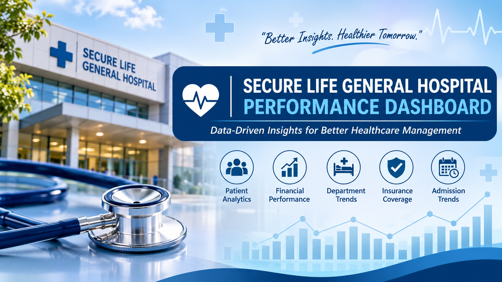
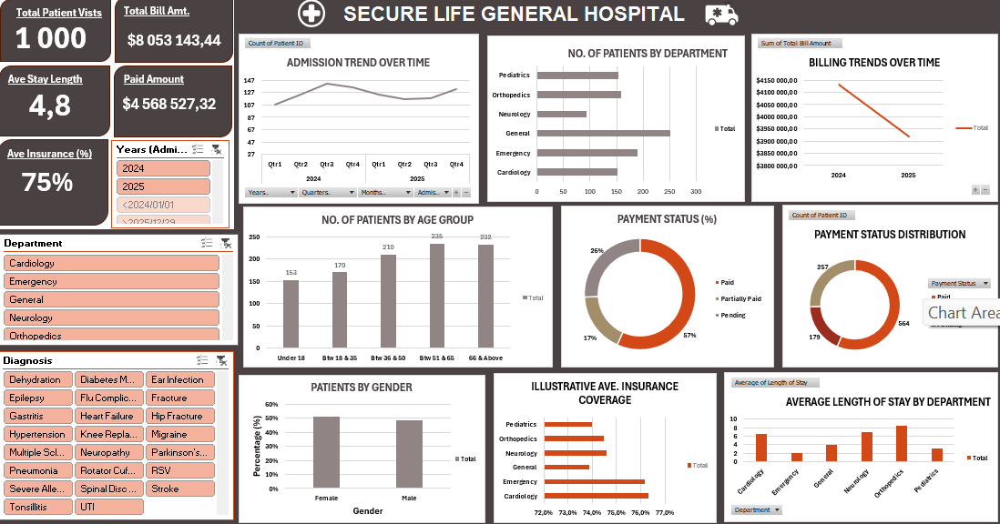

# Secure Life Hospital Data Analysis
Healthcare data analysis project using Microsoft Excel to explore hospital patient visits, billing patterns, payment statuses, and insurance coverage across 2024–2025.

## 1. Introduction

Healthcare facilities generate large amounts of data through patient admissions, medical treatments, billing and payment activities. Analysing this information can help healthcare management understand patient trends, monitor financial performance and make informed operational decisions.
This project focuses on analysing the patient dataset of Secure Life General Hospital using Microsoft Excel. The aim is to transform raw hospital data into meaningful information through data analysis, PivotTables, PivotCharts and an interactive dashboard.
The dashboard provides a visual overview of patient visits, departmental performance, billing information, payment statuses, age distribution and other important healthcare indicators. 

## 2. About the Dataset
The dataset used in this project contains 1,000 patient visit records from Secure Life General Hospital.
It includes information relating to patient demographics, hospital admissions, departments, diagnoses, billing and insurance coverage.
The original dataset contains the following fields:
•	Patient ID
•	Patient Name
•	Age
•	Gender
•	Admission Date
•	Discharge Date
•	Department
•	Diagnosis
•	Total Bill Amount
•	Payment Status
•	Insurance Coverage (%)
Additional calculated columns were included during the analysis:
•	Estimated Insurance Coverage Bill
•	Patient Responsibility Amount
•	Length of Stay
•	Paid Amount
•	Age Category
Each record represents a patient visit. A patient may therefore appear more than once if they visited the hospital on multiple occasions.
To see the **data set** [Click Here](https://1drv.ms/x/c/d71726aa96a624b3/IQDqbCHm8kqtT4FDw8SrfUhYAeh22Lp0Nky9JyfClKVTzzQ?e=2aSOLp)

## 3. Problem Statement
Secure Life General Hospital requires a consolidated view of its patient and financial information to support effective decision-making.
Without an organised way of analysing this information, management may find it difficult to identify departments experiencing high patient demand, understand billing performance, monitor payment statuses and recognise trends in patient admissions.
This project addresses the need for a centralised and interactive dashboard that presents important hospital information in an understandable visual format.
The analysis aims to answer the following management questions:
1.	How many patient visits were recorded?
2.	Which departments receive the highest number of patient visits?
3.	Which departments generate the highest total bill amounts?
4.	What is the average length of stay across departments?
5.	What proportion of bills are paid, pending or partially paid?
6.	How much has been billed, and how much remains outstanding?
7.	How does insurance coverage vary across departments and diagnoses?
8.	Which age groups account for the highest number of visits?
9.	How do patient admissions and billing amounts change over time?
10.	Which areas may require management attention based on the findings?

## 4. Visualisation
The interactive dashboard was developed using Microsoft Excel to present the findings of the analysis.

Figure 1: Secure Life General Hospital Dashboard.

## 5. Key Insights
The analysis revealed several findings from the hospital dataset.
### 5.1 Patient Visits
A total of 1,000 patient visits were recorded in the dataset. This provides an overview of the hospital's recorded patient activity.
### 5.2 Patient Visits by Department
The General Department recorded the highest number of visits, with 252 visits, followed by Emergency with 190 visits.
Neurology recorded the lowest number of visits, with 94.
This indicates that patient demand differs across the hospital's departments.
### 5.3 Departmental Billing Performance
Orthopedics generated the highest total bill amount, approximately 2,553,862.32, despite not recording the highest number of patient visits.
Cardiology followed with approximately 2,095,437.97.
This demonstrates that departments with higher patient volumes do not necessarily generate the highest total billing amounts.
### 5.4 Patient Visits by Age Group
The 51–65 age group recorded the highest number of visits, with 235 visits. This was closely followed by the 66-and-above age group, with 232 visits.
The 36–50 age group recorded 210 visits, while the 18–35 and under-18 age groups recorded 170 and 153 visits respectively.
This indicates that older age groups accounted for a substantial proportion of recorded hospital visits.
### 5.5 Patient Distribution by Gender
The gender distribution was relatively balanced:
•	Female: 51.2%.
•	Male: 48.8%.
This indicates that patient visits were almost evenly distributed between the two gender groups.
### 5.6 Payment Status
The distribution of total bill value across payment statuses was:
•	Paid: 56.73%.
•	Partially Paid: 17.41%.
•	Pending: 25.86%.
These figures indicate that a considerable portion of the hospital's total bill value is associated with partially paid and pending transactions.
### 5.7 Billing and Paid Amount
The total bill amount recorded was 8,053,143.44.
The calculated Paid Amount was 4,568,527.32.
The Paid Amount column was calculated by assigning the full bill amount to records marked as "Paid". Records marked as "Pending" or "Partially Paid" were assigned zero because the dataset did not provide the exact amounts received for those transactions.
Therefore, this figure represents the value of fully paid bills rather than the hospital's complete cash collections.
The exact outstanding balance cannot be determined from the payment statuses alone.
### 5.8 Average Length of Stay
The average patient stay was approximately 4.81 days.
This provides management with an overview of how long patients remained admitted.
### 5.9 Insurance Coverage
The average insurance coverage recorded in the dataset was approximately 74.86%.
This provides an overview of the insurance coverage percentages associated with patient visits. These percentages represent recorded coverage rather than confirmed payments received from insurance providers.
### 5.10 Admission Trends
The dataset contains admission records from 2024 and 2025.
•	2024 recorded 508 patient visits.
•	2025 recorded 492 patient visits.
This represents a slight decrease in recorded visits between the two years.

## 6. Recommendations
Based on the findings, the following recommendations may assist hospital management:
1.	**Monitor departmental demand**: Management should regularly review patient visits across departments to identify areas that may require additional resources or staffing.
2.	**Review departmental billing performance**: Orthopedics and Cardiology generated the highest total bill amounts. Management could investigate the factors contributing to these figures.
3.	**Improve payment monitoring**: The hospital should pay particular attention to pending and partially paid bills to improve financial follow-up and payment tracking.
4.	**Monitor older patient groups**: Since the 51–65 and 66-and-above age groups recorded the highest visit numbers, management could examine the healthcare services and resources required by these groups.
5.	**Improve financial record-keeping**: The hospital should record the exact amount received for every bill, including partially paid transactions. This would allow more accurate calculations of outstanding balances and actual revenue collected.
6.	**Continue monitoring admission trends**: Regular analysis of admission patterns can help management identify changes in patient demand and plan resources accordingly.
7.	**Maintain an updated dashboard**: Regularly updating the dashboard can support continuous monitoring of hospital operations and financial performance.

## 7. Conclusion
This project demonstrates how Microsoft Excel can be used to transform raw healthcare data into meaningful information through data analysis and visualisation.
The interactive dashboard provides an overview of patient visits, departmental activity, age and gender distribution, billing information, payment statuses and insurance coverage.
The findings highlight important differences in departmental demand and billing performance, as well as areas that may require further financial monitoring.
Overall, this project demonstrates the value of data analytics in organising information, identifying trends and supporting informed decision-making within a healthcare environment.

